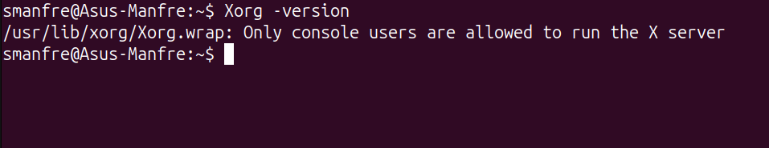
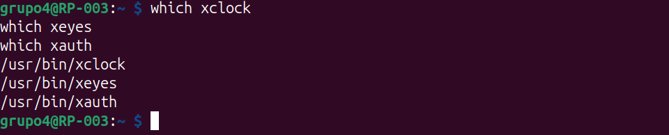
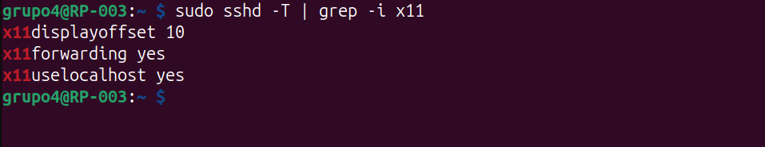
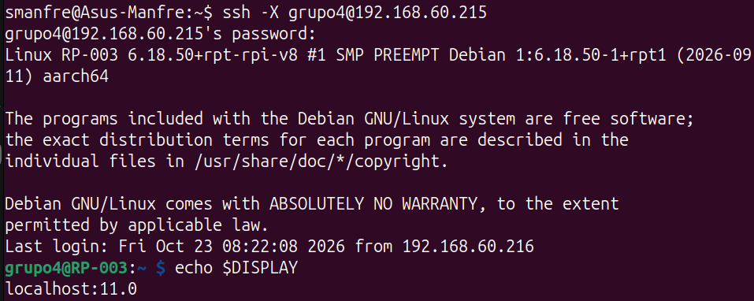
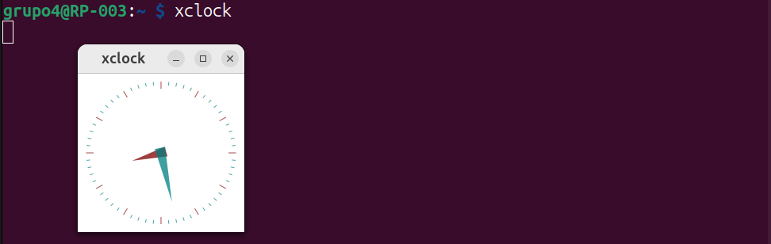

# Instalación del servidor gráfico Xorg y ejecución remota de aplicaciones gráficas por SSH

**Materia:** Telecomunicaciones

**Trabajo Integrador**

**Integrantes:** Alladio - Conejero - Corti - Ferrazzuolo - Manfredini

---

## Índice

- [1. Introducción](#1-introducción)
- [2. Objetivo](#2-objetivo)
- [3. Marco teórico](#3-marco-teórico)
- [4. Materiales utilizados](#4-materiales-utilizados)
- [5. Instalación de Xorg](#5-instalación-de-xorg)
- [6. Instalación de aplicaciones gráficas de prueba](#6-instalación-de-aplicaciones-gráficas-de-prueba)
- [7. Configuración de SSH para X11 Forwarding](#7-configuración-de-ssh-para-x11-forwarding)
- [8. Conexión remota con reenvío de X11](#8-conexión-remota-con-reenvío-de-x11)
- [9. Ejecución de aplicaciones gráficas de prueba](#9-ejecución-de-aplicaciones-gráficas-de-prueba)
- [10. Conclusión](#10-conclusión)

---

## 1. Introducción

En esta segunda etapa se amplió la Raspberry Pi configurada en la Actividad 1 instalando el servidor gráfico **Xorg**, sin gestor de ventanas ni entorno de escritorio. El objetivo es poder ejecutar aplicaciones gráficas instaladas en la Raspberry Pi a través de una conexión SSH, de manera que las ventanas se muestren en la computadora cliente.

De esta forma la Raspberry Pi sigue funcionando como servidor liviano (sin escritorio), pero con la posibilidad de usar herramientas gráficas de forma remota cuando sea necesario.

---

## 2. Objetivo

Instalar el servidor gráfico Xorg en la Raspberry Pi, sin gestor de ventanas ni gestor de escritorio, y configurar el servicio SSH para reenviar la interfaz gráfica (*X11 Forwarding*), de modo que las aplicaciones gráficas ejecutadas en la Raspberry Pi se visualicen en el equipo cliente.

Objetivos específicos:

- Instalar Xorg y las utilidades necesarias sin entorno de escritorio.
- Instalar aplicaciones gráficas de prueba.
- Comprobar que no se instaló ningún gestor de ventanas ni de escritorio.
- Habilitar y verificar el reenvío de X11 en el servidor SSH.
- Conectarse con `ssh -X` y ejecutar aplicaciones gráficas de prueba.
- Verificar que las ventanas se generan en el cliente.

---

## 3. Marco teórico

**Servidor gráfico:** programa encargado de gestionar la pantalla, el teclado y el mouse, y de dibujar las ventanas de las aplicaciones. Sin un servidor gráfico, un sistema solo puede mostrar texto en la terminal.

**X Window System (X11):** sistema de ventanas para entornos Unix/Linux basado en una arquitectura **cliente-servidor**. Una característica importante es su **transparencia de red**: la aplicación y el servidor gráfico pueden estar en equipos distintos.

**Xorg:** implementación libre y ampliamente utilizada del servidor X11.

**Servidor X y cliente X:** en la terminología de X11 los roles pueden resultar contraintuitivos:

- **Servidor X:** es el programa que está frente al usuario, maneja la pantalla, el teclado y el mouse, y dibuja las ventanas. En esta actividad corre en la computadora cliente.
- **Cliente X:** es la aplicación gráfica (por ejemplo `xclock` o `xeyes`). Envía al servidor X las instrucciones de dibujo. En esta actividad corre en la Raspberry Pi.

Es decir que la aplicación se ejecuta (lógica, cálculos, archivos) en la Raspberry Pi, pero el dibujado de las ventanas lo realiza el equipo del usuario.

**Gestor de ventanas y gestor de escritorio:** el gestor de ventanas (por ejemplo Openbox) maneja el aspecto y la posición de las ventanas (bordes, barras de título, mover y redimensionar). El entorno de escritorio (por ejemplo XFCE o GNOME) incluye además panel, menús, aplicaciones y configuración. En esta actividad **no se instala ninguno de los dos**, ya que las ventanas serán gestionadas por el equipo cliente.

**X11 Forwarding sobre SSH:** funcionalidad de SSH que crea un túnel cifrado por el cual viaja el tráfico de X11. Al conectarse con `ssh -X`, SSH define automáticamente la variable de entorno `DISPLAY` en el servidor apuntando al extremo del túnel, y gestiona las credenciales de autenticación de X mediante `xauth`. Así, cualquier aplicación gráfica lanzada en la sesión SSH se mostrará en el servidor X del cliente.

**Variable `DISPLAY`:** indica a las aplicaciones gráficas dónde deben mostrar sus ventanas. Con X11 Forwarding toma un valor similar a `localhost:10.0`.

**`xauth`:** utilidad que administra las credenciales (*cookies*) que autorizan a una aplicación a conectarse a un servidor X.

---

## 4. Materiales utilizados

- Raspberry Pi con Raspberry Pi OS Lite y SSH habilitado (Actividad 1).
- Computadora cliente con un servidor X en funcionamiento, conectada a la misma red local.
- Cliente SSH instalado en la computadora cliente.

| Elemento | Dato |
|---|---|
| Modelo de Raspberry Pi | Raspberry Pi 3 Model B Rev 1.2 |
| Sistema operativo | Raspberry Pi OS Lite (sin entorno de escritorio) |
| Usuario | `grupo4` |
| Dirección IP | `192.168.60.215` |
| Servidor X del cliente | Servidor gráfico X11 |

---

## 5. Instalación de Xorg

Primero se actualizó la lista de paquetes y se actualizaron los paquetes instalados. Luego se instaló el servidor gráfico y sus componentes:

```bash
sudo apt update
sudo apt full-upgrade -y
sudo apt install xorg -y
```

**Explicación de los comandos:**

- `sudo`: ejecuta el comando con privilegios administrativos.
- `apt update`: actualiza la lista de paquetes disponibles en los repositorios.
- `apt full-upgrade`: actualiza los paquetes instalados a sus versiones disponibles y puede instalar o quitar paquetes para resolver dependencias.
- `apt install`: instala los paquetes indicados.
- `xorg`: metapaquete que instala el servidor gráfico Xorg y sus componentes.
- `-y`: responde "sí" automáticamente a las confirmaciones.

Se verificó la instalación con:

```bash
Xorg -version
```

### Evidencia



---

## 6. Instalación de aplicaciones gráficas de prueba

Para comprobar el funcionamiento de las aplicaciones gráficas, se instalaron `x11-apps` y `xauth`.

```bash
sudo apt install x11-apps xauth -y
```

**Explicación de los paquetes:**

- `x11-apps`: incluye aplicaciones gráficas sencillas de prueba, como `xclock` y `xeyes`.
- `xauth`: administra las credenciales de autenticación que permiten a las aplicaciones conectarse al servidor X.

Estas herramientas permiten comprobar el reenvío de X11 sin necesidad de instalar un entorno de escritorio completo.

Se verificó la disponibilidad de las aplicaciones mediante:

```bash
which xclock
which xeyes
which xauth
```

Los comandos muestran las rutas de los ejecutables cuando están instalados y disponibles en el `PATH`.

### Evidencia



---

## 7. Configuración de SSH para X11 Forwarding

Se consultó la configuración vigente del servidor SSH:

```bash
sudo sshd -T | grep -i x11
```

**Explicación del comando:**

- `sshd -T`: muestra la configuración efectiva del servidor SSH.
- `grep -i x11`: filtra las opciones relacionadas con X11, sin distinguir entre mayúsculas y minúsculas.

Resultado obtenido:

```text
x11displayoffset 10
x11forwarding yes
x11uselocalhost yes
```

Estas opciones indican que el reenvío de X11 está habilitado y que el extremo local del túnel se limita a las interfaces de loopback.

### Evidencia



---

## 8. Conexión remota con reenvío de X11

Desde la terminal de la computadora cliente se realizó la conexión habilitando el reenvío de X11:

```bash
ssh -X grupo4@192.168.60.215
```

**Explicación del comando:**

- `ssh`: establece una conexión mediante el protocolo SSH.
- `-X`: habilita el reenvío de X11 (*X11 Forwarding*).
- `grupo4@192.168.60.215`: usuario y dirección IP de la Raspberry Pi.

Una vez autenticado, se comprobó que SSH configuró la variable `DISPLAY`:

```bash
echo $DISPLAY
```

El resultado esperado es similar a `localhost:10.0`.

Este valor indica que SSH configuró un punto de acceso al servidor X para la sesión remota.

Para que funcione, la computadora cliente debe tener un servidor X en funcionamiento y el servidor SSH de la Raspberry debe permitir el reenvío de X11.

### Evidencia



---

## 9. Ejecución de aplicaciones gráficas de prueba

Dentro de la sesión SSH se ejecutaron dos aplicaciones gráficas: `xeyes` y `xclock`, incluidas en el paquete `x11-apps`.

```bash
xeyes &
xclock &
```

**Explicación de los comandos:**

- `xeyes`: aplicación gráfica de prueba que muestra unos ojos que siguen al cursor.
- `xclock`: muestra un reloj analógico.
- `&`: ejecuta el programa en segundo plano, dejando libre la terminal.

Si la configuración es correcta, ambas ventanas deberían visualizarse en la computadora cliente, aunque los programas se estén ejecutando en la Raspberry Pi.

### Evidencia



---

## 10. Conclusión

Se instaló el servidor gráfico Xorg en la Raspberry Pi sin gestor de ventanas ni entorno de escritorio, manteniendo el sistema liviano. También se instalaron las aplicaciones gráficas de prueba `x11-apps` y la utilidad `xauth`.

Se verificó el reenvío de X11 en el servicio SSH y, mediante `ssh -X`, se ejecutaron aplicaciones gráficas en la Raspberry Pi cuyas ventanas se mostraron en el equipo cliente. De esta manera, la Raspberry Pi ejecuta la lógica de las aplicaciones, mientras que el servidor X del cliente proporciona la visualización de las ventanas, sin necesidad de conectar un monitor al servidor ni de instalar un escritorio gráfico completo.